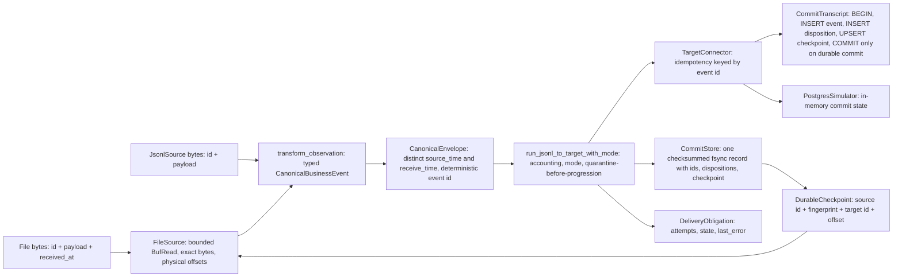

# JSONL -> PostgreSQL reference application (Platforms P5 and P6)

This document records a **second, genuinely non-market-data reference
application** built on the generic canonical envelope. Its purpose is to prove
source/target independence: the same
[`CanonicalEnvelope<T>`](CANONICAL_EVENT_MODEL.md) that the market-data
collector uses can carry a different payload, from a different source, into a
different target, without touching collector core, exchange adapters, SBE, the
raw-frame journal, replay or the catalog.

P5 established the in-memory source plus the SQL/simulator contract. **P6 adds a
real local durable commit path, a bounded streaming file source with a
content-bound resume anchor, corrected delivery semantics and a database
executor seam.** It still adds no dependency and no live connection.

## Architecture proof

The reference application is a straight, explicit pipeline:

Five boundaries make the independence claim falsifiable:

1. **Source boundary.** [`SourceAdapter`](../src/application.rs) returns one
   `RawObservation` at a time with exact retained bytes, a local sequence and a
   stable provenance pointer. The in-memory `JsonlSource` rejects malformed
   JSON, unsupported schema versions and duplicate record ids with evidence.
   The P6 [`FileSource`](../src/application/file_source.rs) does the same with a
   fixed-capacity `BufRead` buffer, adds the physical byte offset of every
   line, and computes a SHA-256 fingerprint of the complete file **once before**
   streaming.
2. **Payload boundary.** [`CanonicalBusinessEvent`](../src/application.rs) is
   `{ entity_id, kind, value, observed_at }`. It has no price, side, venue,
   instrument, book or market concept. The transform is a pure function of the
   observation: no clock, environment or randomness is read, and the event id
   is derived only from source identity plus record id so retries and resumes
   reuse the same idempotency key. `source_time` comes from `observed_at` and
   `receive_time` comes from an explicit `received_at` when supplied (legacy
   inputs without `received_at` fall back to `observed_at`, documented rather
   than silently conflated).
3. **Target boundary.** [`TargetConnector`](../src/application.rs) accepts a
   batch with an idempotency key and returns a receipt reported in six
   categories: `Delivered`, `DurableCommitted`, `Simulated`, `Outstanding`,
   `Uncertain`, `Rejected`. `Accepted` is a legacy non-terminal variant reported
   as `Delivered`. Non-terminal outcomes leave a `DeliveryObligation` and refuse
   to advance the checkpoint. `DurableCommitted` and `Rejected` are terminal
   only after the local store has accepted the atomic commit record.
4. **Execution boundary.** [`ExecutionMode`](../src/application.rs) is `Live`,
   `DryRun` or `Replay`. Simulated modes report `Simulated`, never
   `DurableCommitted`, do not call a real target and do not move the durable
   checkpoint. `ReplayConnector` is explicitly marked simulation-safe so its
   receipts can still be recorded without touching the wrapped target.
5. **Durability boundary.** [`CommitStore`](../src/application/durable.rs)
   writes each commit as a separate, never-rewritten checksummed JSON file via
   `write_json_atomic` (sibling temporary file, fsync, rename, parent-directory
   fsync). One record atomically contains the committed event ids, the
   dispositions/quarantine evidence and the new checkpoint. Reopen recomputes
   every checksum and rejects truncation, corruption, unsupported versions,
   sequence gaps and checkpoint-binding mismatches.

The runner
`run_jsonl_to_target_with_mode(source, transform, target, checkpoint, mode,
sink)` accounts every physical input line into disjoint buckets. Exact evidence
references are in the [requirement-to-test matrix](requirement-test-matrix.md)
under P5 and P6. The integration test
`tests/jsonl_postgres_reference.rs::reference_modules_have_no_market_data_dependencies`
statically checks that all four reference modules contain no market-data module
or concept tokens; `scripts/check_architecture.py` enforces the same rule.

## Implemented

- `src/application.rs`: unchanged `JsonlSource`, plus `ExecutionMode`,
  `ReceiptCategory`, `CommitIntent`, `DispositionRecord`, `QuarantineRecord`,
  `CommitSink`, `NoopCommitSink`, the corrected runner and the time-separated
  transform.
- `src/application/file_source.rs`: `SourceFingerprint`, `SourceIdentity`,
  `SourceRegistry`, `CheckpointBinding`, `DurableCheckpoint`, `DuplicatePolicy`
  and the bounded `FileSource` with `open`/`with_resume`.
- `src/application/durable.rs`: `CommitRecord`, `CommitEnvelope`, `CommitStore`,
  `DurableState`, `StoreFault`, `load_state` and `run_streaming_pipeline`.
- `src/application/postgres.rs`: parameterized SQL generation, a deterministic
  in-memory simulator, target-specific `IdempotencyKey`, `CommitTranscript`,
  `SqlExecutor`, `RecordingExecutor` and fault injections. No COMMIT is emitted
  for a non-terminal receipt.
- Deterministic offline tests for bounded reads and offsets, fingerprint-bound
  resume, duplicate/malformed evidence, restart from a durable store, quarantine
  before progression, DB-unavailable checkpoint stability, independent target
  obligations, simulated modes, partial/corrupt commit records and SQL shape.

## Planned, not implemented

- A real PostgreSQL driver (`tokio-postgres`) and connection pool. Wiring one
  to [`SqlExecutor`](../src/application/postgres.rs) is a **separate dependency
  decision**; this work adds no dependency and no `Cargo.toml` change.
- A live database, migrations executed against a real server, and production
  durability or recovery testing. The local store is single-writer and has no
  replication, quorum, multi-site or retention policy.
- Any performance, throughput, latency, scale or live-environment claim. The
  simulator is in-memory and all tests are local and deterministic. SQL text is
  checked for shape only; no query plan or server behavior is exercised.

## Compatibility

No existing market-data source file was changed other than the additive module
declarations. `ExchangeEvent`, `MarketInfo`, the SBE schema and writer, journal
format, replay format, catalog, coordinator and collector state are untouched.
No dependency was added and all existing P5 and market-data tests remain.
