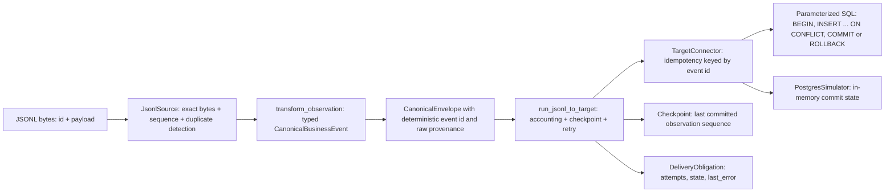

# JSONL -> PostgreSQL reference application (Platform P5)

This document records a **second, genuinely non-market-data reference
application** built on the generic canonical envelope. Its purpose is to prove
source/target independence: the same
[`CanonicalEnvelope<T>`](CANONICAL_EVENT_MODEL.md) that the market-data
collector uses can carry a different payload, from a different source, into a
different target, without touching collector core, exchange adapters, SBE, the
raw-frame journal, replay or the catalog.

## Architecture proof

The reference application is a straight, explicit pipeline:

Three boundaries make the independence claim falsifiable:

1. **Source boundary.** [`SourceAdapter`](../src/application.rs) returns one
   `RawObservation` at a time with exact retained bytes, a local sequence and a
   stable provenance pointer. `JsonlSource` rejects malformed JSON, unsupported
   schema versions and duplicate record ids with evidence (sequence, line
   number, exact bytes), rather than silently skipping them.
2. **Payload boundary.** [`CanonicalBusinessEvent`](../src/application.rs) is
   `{ entity_id, kind, value, observed_at }`. It has no price, side, venue,
   instrument, book or market concept. The transform is a pure function of the
   observation: no clock, environment or randomness is read, and the event id
   is derived only from source identity plus record id so retries and resumes
   reuse the same idempotency key.
3. **Target boundary.** [`TargetConnector`](../src/application.rs) accepts a
   batch with an idempotency key and returns one of five explicit receipts:
   `Accepted`, `DurableCommitted`, `Rejected`, `Uncertain`, `Outstanding`.
   `Accepted`, `Uncertain` and `Outstanding` are non-terminal; they leave a
   `DeliveryObligation` and refuse to advance the checkpoint. Only a durable
   commit or a terminal rejection advances the committed sequence.

The runner `run_jsonl_to_target(source, transform, target, checkpoint)` accounts
every physical input line into disjoint buckets (delivered, duplicate,
rejected, outstanding, uncertain, accepted, skipped). Replay is a
`ReplayConnector` that synthesizes receipts without calling the wrapped target,
so replay performs no destination side effect. The integration test
`tests/jsonl_postgres_reference.rs::reference_modules_have_no_market_data_dependencies`
statically checks that the new modules contain no market-data module or concept
tokens; `scripts/check_architecture.py` enforces the same rule in CI.

## Implemented

- `src/application.rs`: `SourceAdapter`, `JsonlSource`, `RawObservation`,
  `SourceError` evidence, `CanonicalBusinessEvent`, the deterministic
  transform, `TargetConnector`, five-way `DeliveryReceipt`, `DeliveryObligation`,
  `Checkpoint`, `ImportReport`, `ReplayConnector` and the resumable runner.
- `src/application/postgres.rs`: parameterized SQL generation
  (`INSERT INTO canonical_business_events ... VALUES ($1..$8) ON CONFLICT
  (event_id) DO NOTHING` between `BEGIN` and `COMMIT`/`ROLLBACK`), a
  `PostgresTarget` facade that records generated statements, obligations and
  receipts, and a deterministic in-memory `PostgresSimulator` with idempotency
  by event id, commit/rollback, and `ServerUnavailable` / `AckLost` fault
  injection.
- Deterministic offline tests for normal accounting, duplicate input
  idempotency, interrupted resume, outstanding on unavailable target, safe
  resolution of a lost acknowledgement, replay with side effects disabled,
  schema rejection, malformed-line evidence, and SQL shape. Exact references
  are in the [requirement-to-test matrix](requirement-test-matrix.md) under P5.

## Planned, not implemented

- A real PostgreSQL driver (`tokio-postgres`) and connection pool. Wiring one
  to the `TargetConnector` seam is a **separate dependency decision**; this
  work adds no dependency and no `Cargo.toml` change.
- A live database, migrations executed against a real server, and production
  durability or recovery testing.
- Any performance, throughput, latency, scale or live-environment claim. The
  simulator is in-memory and all tests are local and deterministic. SQL text is
  checked for shape only; no query plan or server behavior is exercised.

## Compatibility

No existing market-data source file was changed other than the additive module
declarations in `src/lib.rs`. `ExchangeEvent`, `MarketInfo`, the SBE schema and
writer, journal format, replay format, catalog, coordinator and collector state
are untouched. No dependency was added.
