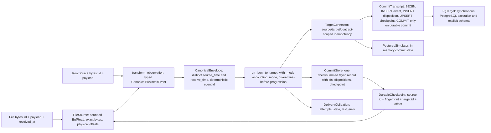

# JSONL-to-target reference application

This document records a **second, genuinely non-market-data reference
application** built on the generic canonical envelope. Its purpose is to prove
source/target independence: the same
[`CanonicalEnvelope<T>`](canonical-event-model.md) that the market-data
collector uses can carry a different payload, from a different source, into a
different target, without touching collector core, exchange adapters, SBE, the
raw-frame journal, replay or the catalog.

P5 established the in-memory source plus the SQL/simulator contract. **P6 adds a
real local durable commit path, a streaming file source with a content-bound
resume anchor, corrected delivery semantics and a database executor seam.**
A real PostgreSQL target now applies the same transcript through a synchronous
driver; it is opt-in and requires an operator-supplied server. The checkpoint
namespace is `(target_id, source_id, output_contract_version)`, and the
checksum binds all three identity components plus sequence, byte offset and
last idempotency key. Database checkpoint writes require strict sequence/offset
advancement, except for an identical-position retry of the same event id;
competing events at one source position are rejected transactionally. Event
and disposition rows carry the source identity. Older rows migrate into the
explicit empty-source namespace and retain v1/v2 historical checksum
validation until an operator maps them with `assign_legacy_checkpoint_source`.
That procedure verifies the stored legacy checksum, re-keys both historical
three-part and explicit empty-source four-part event/disposition keys, checks
that event and disposition identity sets match and that the checkpoint's last
key has both rows, then rebinds the checkpoint to the source-scoped v4 checksum
in one transaction. An invalid or incomplete legacy position is never
legitimized by mapping. Reusing an event key with changed canonical content is
rejected after a full persisted-row
comparison. The target, supplied checkpoint and envelope must all name the
same source. `PgTarget::with_source` is the required constructor for modern
non-empty source identities; `PgTarget::new` and `with_checkpoint` are limited
to the explicit empty-source legacy namespace. Empty source is not a wildcard:
a modern envelope cannot be written while erasing its provenance. The target
supports bounded, ordered multi-event batches in one transaction; it rejects
empty, cross-source or unordered batches instead of silently truncating them.
The bounded runner flushes a pending batch before quarantining a malformed
record and commits one checksummed local record per batch.

## Independent network source

`src/application/network_source.rs` supplies a second `SourceAdapter` over a
loopback TCP stream. It speaks a minimal handshake (`HELLO` / `TOKEN`) and then
reuses the same line parser, exact duplicate index and resume anchor as the
file source. The declared token identifies the stream; it is not a
whole-stream hash, so a resume anchor does not claim content completeness.
`tests/network_source.rs` runs a local server that replays the declared stream,
closes it early to force a reconnect, injects a malformed line, and soaks
2,000 records across disconnects. The generic pipeline, commit store and
target need no market-data dependency.

## Architecture proof

The reference application is a straight, explicit pipeline:

Five boundaries make the independence claim falsifiable:

**Source boundary.** [`SourceAdapter`](../src/application.rs) returns one
   `RawObservation` at a time with exact retained bytes, a local sequence and a
   stable provenance pointer. The in-memory `JsonlSource` rejects malformed
   JSON, unsupported schema versions and duplicate record ids with evidence.
   The P6 [`FileSource`](../src/application/file_source.rs) does the same with a
   fixed-capacity `BufRead` buffer, adds the physical byte offset of every
   line, and computes a SHA-256 fingerprint of the complete file **once before**
   streaming with a fixed 64 KiB read buffer. Exact duplicate-id detection
   uses a fixed-size in-memory bucket table whose entry chains live in a
   scratch file removed on drop, so memory does not grow with source
   cardinality.
**Payload boundary.** [`CanonicalBusinessEvent`](../src/application.rs) is
   `{ entity_id, kind, value, observed_at }`. It has no price, side, venue,
   instrument, book or market concept. The transform is a pure function of the
   observation: no clock, environment or randomness is read, and the event id
   is derived only from source identity plus record id so retries and resumes
   reuse the same idempotency key. `source_time` comes from `observed_at` and
   `receive_time` comes from an explicit `received_at` when supplied (legacy
   inputs without `received_at` fall back to `observed_at`, documented rather
   than silently conflated).
**Target boundary.** [`TargetConnector`](../src/application.rs) accepts a
   batch with an idempotency key and returns a receipt reported in six
   categories: `Delivered`, `DurableCommitted`, `Simulated`, `Outstanding`,
   `Uncertain`, `Rejected`. `Accepted` is a legacy non-terminal variant reported
   as `Delivered`. Non-terminal outcomes leave a `DeliveryObligation` and refuse
   to advance the checkpoint. `DurableCommitted` and `Rejected` are terminal
   only after the local store has accepted the atomic commit record.
**Execution boundary.** [`ExecutionMode`](../src/application.rs) is `Live`,
   `DryRun` or `Replay`. Simulated modes report `Simulated`, never
   `DurableCommitted`, do not call a real target and do not move the durable
   checkpoint. `ReplayConnector` is explicitly marked simulation-safe so its
   receipts can still be recorded without touching the wrapped target.
**Durability boundary.** [`CommitStore`](../src/application/durable.rs)
   writes each commit as a separate, never-rewritten checksummed JSON file via
   `write_json_atomic` (sibling temporary file, fsync, rename, parent-directory
   fsync). One record atomically contains the committed event ids, the
   dispositions/quarantine evidence and the new checkpoint. Reopen recomputes
   every checksum and rejects truncation, corruption, unsupported versions,
   sequence gaps and checkpoint-binding mismatches.

The runner
`run_jsonl_to_target_with_mode(source, transform, target, checkpoint, mode,
sink)` accounts every physical input line into disjoint buckets. Exact evidence
references are in the [requirement-to-test matrix](requirement-test-matrix.md)
under P5 and P6. The integration test
`tests/jsonl_postgres_reference.rs::reference_modules_have_no_market_data_dependencies`
statically checks that all four reference modules contain no market-data module
or concept tokens; `scripts/check_architecture.py` enforces the same rule.

## Implemented

`src/application.rs`: unchanged `JsonlSource`, plus `ExecutionMode`,
  `ReceiptCategory`, `CommitIntent`, `DispositionRecord`, `QuarantineRecord`,
  `CommitSink`, `NoopCommitSink`, the corrected runner and the time-separated
  transform.
`src/application/file_source.rs`: `SourceFingerprint`, `SourceIdentity`,
  `SourceRegistry`, `CheckpointBinding`, `DurableCheckpoint`, `DuplicatePolicy`
  and the fixed-buffer `FileSource` with `open`/`with_resume`. Its exact
  duplicate-id index keeps a fixed-size bucket table in memory and appends
  entries to a scratch file.
`src/application/durable.rs`: `CommitRecord`, `CommitEnvelope`, `CommitStore`,
  `DurableState`, `StoreFault`, `load_state` and `run_streaming_pipeline`.
`src/application/postgres.rs`: parameterized SQL generation, a deterministic
  in-memory simulator, target-specific `IdempotencyKey`, `CommitTranscript`,
  `SqlExecutor`, `RecordingExecutor`, `PgExecutor`, `PgTarget` and explicit
  migrations. The live target executes the transcript through the synchronous
  `postgres` driver; only a durable receipt emits COMMIT.
- Deterministic offline tests for bounded reads and offsets, fingerprint-bound
  resume, duplicate/malformed evidence, restart from a durable store, quarantine
  before progression, DB-unavailable checkpoint stability, independent target
  obligations, simulated modes, partial/corrupt commit records and SQL shape.

## Implemented live integration and remaining limits

The synchronous `postgres` dependency is wired through `PgExecutor` and
`PgTarget`. `apply_migrations` applies the explicit schema, and the ignored
`tests/postgres_live.rs::postgres_live_source_scoped_delivery` test drives an
operator-supplied database. It passed against PostgreSQL 18.6; the exact
command, output and SHA-256 hashes are retained in
`measurements/live/2026-11-18-postgres-source-scoped/`, with `source_commit`
naming the exact code commit tested. It is an opt-in test, not run by CI.

The TCP source in `src/application/network_source.rs` is a small
loopback reference protocol. Its tests exercise a local server, clean-disconnect
resume, malformed-line quarantine and a 2,000-record reconnect soak. It is not
a production authenticated network connector or proof of arbitrary remote
source continuity; its declared token identifies a stream but is not a
whole-stream content hash.

Still not implemented or certified: connection pooling and production
connection lifecycle management; replicated or quorum durability; multi-site
recovery; target failover/soak evidence; production network-source security and
continuity; and reproducible throughput, latency or scale claims. The local
commit store remains single-writer and local-filesystem scoped.

## Compatibility

No existing market-data source file was changed other than the additive module
declarations. `ExchangeEvent`, `MarketInfo`, the SBE schema and writer, journal
format, replay format, catalog, coordinator and collector state are untouched.
The synchronous `postgres` crate is an added application-layer dependency.
Existing market-data contracts and formats remain unchanged; P5/P6 tests are
additive.
